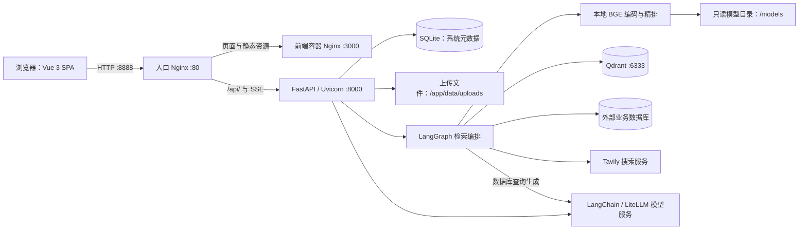
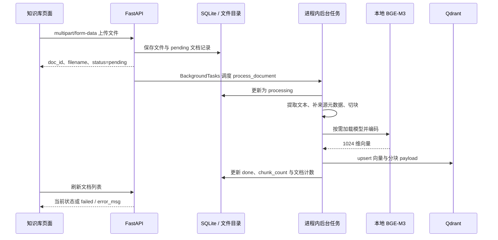
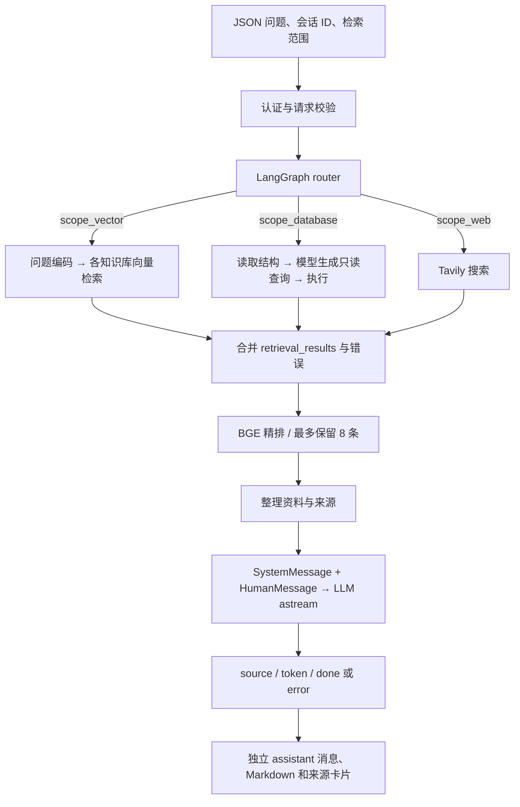

# EnterpriseRag · v1

> 版本切换：当前为 **V1（Docker 部署 / 本地 BGE）** · [查看 V2（Windows 轻量交付 / 在线 Embedding）](https://github.com/tomkluas/EnterpriseRag/blob/V2/README.md)

企业知识库与 RAG 系统，使用 Vue 3、FastAPI、LangGraph、Qdrant 和本地 BGE 模型。

**v1 定位：本地部署的企业资料检索与问答站点。** 已验证登录、管理操作、文件入库、知识库检索、真实模型流式回答、来源展示和联网搜索。全部 23 个业务接口已纳入认证与交互检查；外部业务数据库的实际连通性仍需在配置对应服务后验证，详见[验证](#验证)与[已知限制](#已知限制)。

## 技术组成

| 服务 | 技术与职责 |
| --- | --- |
| 网站入口 | Nginx，本机 `8888` 端口 |
| 前端 | Vue 3、Vite、Pinia、Vue Router |
| 后端 | Python 3.11、FastAPI、SQLAlchemy |
| 系统数据 | SQLite，保存用户、模型配置、知识库及文档状态 |
| 向量数据 | Qdrant，1024 维稠密向量 |
| 文本编码 | `BAAI/bge-m3`，默认 CPU |
| 精排 | `BAAI/bge-reranker-v2-m3`，默认 CPU |
| 模型服务适配 | LangChain / LiteLLM；默认配置使用 DeepSeek |
| 检索编排 | LangGraph，按知识库、业务数据库、联网搜索范围选择检索分支 |
| 联网搜索 | Tavily，查询网页资料并保留标题和 URL 来源 |
| 页面通信 | Axios 处理 JSON / 文件请求；Fetch + ReadableStream 接收 POST SSE |

## 整体技术路线

系统采用“浏览器单页应用 → 同源反向代理 → API 与检索编排 → 本地存储 / 外部服务”的结构。文档编码和精排在本机执行，大模型回答通过配置的模型服务生成；资料入库与提问检索是两条独立流水线。



### 分层职责与关键选型

| 层次 | 当前实现 | 在站点中的作用 |
| --- | --- | --- |
| 页面与状态 | Vue 3、Vue Router、Pinia | 登录、聊天、知识库和管理页面；管理登录信息及当前浏览器会话 |
| 展示 | Markdown-it、Highlight.js、DOMPurify | 将回答渲染为 Markdown，代码高亮，并清理 HTML；来源卡片单独展示资料 |
| API | FastAPI 0.111、Pydantic、Uvicorn | 请求校验、依赖注入、认证授权、上传接收和 SSE 输出 |
| 元数据访问 | SQLAlchemy 2.0 + SQLite | 保存用户、模型配置、业务连接、知识库、文档处理状态 |
| 流程编排 | LangGraph 0.1 | 路由检索范围，合并各分支资料及错误，交给精排节点 |
| 文档预处理 | pdfplumber、python-docx、openpyxl、LangChain splitter | 提取页面 / 段落 / 工作表文本，按中文分隔符切块 |
| 本地模型 | FlagEmbedding、PyTorch、BGE-M3、BGE reranker | 将文本编码为向量；对查询与候选文本的相关性重新评分 |
| 向量索引 | Qdrant 1.9.3 | 每个知识库独立 collection，保存 1024 维向量及文本来源 payload |
| 生成模型适配 | LangChain ChatLiteLLM + LiteLLM | 统一调用 DeepSeek、OpenAI、Ollama 或自定义服务；使用 LangChain 消息对象和 `astream` |
| 业务数据库 | SQLAlchemy 驱动、PyMongo | 获取可见结构，执行受限制的只读查询，将结果转成检索资料 |

精确依赖以 [backend/requirements.txt](backend/requirements.txt) 和 [frontend/package-lock.json](frontend/package-lock.json) 为准。当前 BGE-M3 只使用稠密向量输出，尚未启用稀疏向量或 ColBERT 混合检索。精排模型只排序资料，不生成回答。

### 部署与持久化边界

完整部署包含入口 Nginx、前端、后端、Qdrant 四个容器，使用 Compose 内部服务名通信。浏览器统一访问 `localhost:8888`，避免前端直接依赖容器 IP；后端连接向量库时使用 `qdrant:6333`，不能用容器内的 `localhost` 代替其他服务。

| 数据 | 存放位置 | 生命周期与用途 |
| --- | --- | --- |
| 系统元数据 | `data/rag_system.db` → `/app/data/rag_system.db` | SQLite 表：`users`、`llm_configs`、`db_connections`、`knowledge_bases`、`documents` |
| 原始上传文件 | `data/uploads/` → `/app/data/uploads/` | 使用随机存储名避免覆盖；原文件名保留在文档记录与来源中 |
| 向量与分块正文 | 命名卷 `qdrant_data` → `/qdrant/storage` | 按知识库 ID 建 collection，按文档 ID 过滤清理向量 |
| 模型权重 | `models/` → `/models`，只读 | BGE 编码与精排模型，可由下载脚本重新准备 |
| 模型缓存 | 命名卷 `bge_cache` | Hugging Face 缓存，不代替权重目录或业务数据备份 |
| 登录状态 | 浏览器 `localStorage` + Pinia | 保存 JWT 及用户标识；服务端仍逐请求检查用户与权限 |
| 聊天会话、消息和来源 | 浏览器 Pinia 内存 | 当前不写入 SQLite；刷新页面后会话丢失，退出登录时清空 |

SQLite 保存“文件是谁、属于哪个库、是否处理完成”，Qdrant 保存“可检索的文本块、向量和来源”，文件目录保存原件。三者相互关联但没有跨存储事务，备份恢复时应协调处理。模型权重和真实 `.env` 不进入 Git。

## 主要数据流

### 1. 登录与管理操作

1. 登录页向 `POST /api/v1/auth/login` 发送 JSON 用户名和密码。
2. 后端查询 SQLite 中的用户，检查 bcrypt 密码哈希与启用状态，签发带有效期的 JWT。
3. 浏览器保存令牌，后续普通请求和聊天 SSE 请求均带 `Authorization: Bearer ...`。前端路由守卫负责页面跳转，服务端的 `get_current_user` / `require_admin` 才负责最终权限判断。
4. 服务端按令牌中的用户 ID 重新查询账号，已禁用账号、无效或过期令牌不能继续访问。认证失效时，前端清理状态并返回登录页。
5. 管理员新增模型配置、数据库连接、用户时均发送 **JSON 请求体**；模型 API Key 和数据库连接凭据通过 AES-GCM 加密后写入 SQLite，用户密码保存为 bcrypt 哈希，列表与创建响应不返回加密凭据。

模型“连接测试”会实际调用服务，而不只构造客户端；数据库测试实际读取结构，“刷新 Schema”还会写入连接记录的结构缓存。设置默认模型、用户启停、删除资源均由独立 API 完成。当前数据库检索节点每次读取实际结构，并未直接用该缓存代替结构查询。

### 2. 文件上传、解析与向量入库



- **文件接收**：API 支持 PDF、DOCX、XLSX、TXT、Markdown，校验知识库、文件名、后缀、空文件和大小。后端默认上限为 50 MiB；入口代理的上传限制也需匹配，大文件可能先被 Nginx 以 413 拒绝。
- **文本提取**：PDF 按页提取可复制文本；DOCX 汇集段落；XLSX 按工作表提取单元格；TXT / Markdown 按 UTF-8 读取。当前没有 OCR，扫描图片型 PDF 不会自动转成文字。
- **切块**：`RecursiveCharacterTextSplitter` 优先按换行和中文标点分割，默认每块 512 个字符、重叠 64 个字符；这里按字符长度计算，不是模型 token 数。
- **来源元数据**：每块携带 `kb_id`、`doc_id`、`filename`、`page`。PDF 保留页码；其他格式的“页”是解析器提供的逻辑页，不能等同于排版后的页码。
- **向量写入**：每个知识库使用自己的 collection，距离为余弦相似度；payload 包含分块正文与来源字段。point ID 根据知识库 ID、文档 ID、块序号生成确定性 UUID，避免跨文档互相覆盖。
- **状态与失败**：`pending → processing → done`；异常更新为 `failed` 并记录 `error_msg`。上传返回成功只表示接收成功，需看文档列表确认最终处理结果。列表展示的文档数按实际 `done` 记录统计。

删除文档会先按 `doc_id` 清理向量，再清理原文件与数据库记录；删除知识库会清理 collection 及关联文档。向量清理失败时返回可重试错误并保留记录，处理中的文档 / 知识库暂不允许删除。后台处理使用 FastAPI 进程内任务，尚未引入独立任务队列或重启恢复机制。

### 3. 提问、多路检索与回答



聊天入口为 `POST /api/v1/chat/stream`，最小请求是：

```json
{
  "session_id": "browser-session-id",
  "query": "帖子的需求是什么？",
  "scope_vector": true,
  "scope_database": false,
  "scope_web": false,
  "knowledge_ids": [],
  "db_connection_ids": [],
  "llm_config_id": null
}
```

`knowledge_ids=[]` 表示全部知识库，`db_connection_ids=[]` 表示全部活跃业务连接；对应分支仍受 `scope_*` 开关控制。当前聊天页默认开启知识库，发送空 ID 数组，尚未把所有范围选择能力都做成页面控件。`session_id` 当前用于标识浏览器会话，不会据此加载服务端历史。

1. `ChatRequest` 校验 JSON，生成 `RAGState`，包括问题、检索开关、ID 范围、模型配置及结果列表。
2. LangGraph 按开关激活检索分支。各分支返回统一结构：`text`、`source_type`、`source_name`、`source_detail`、`score`；结果列表追加合并，多个分支的错误也合并，避免并发覆盖状态。
3. 向量分支将问题编码为 1024 维向量，对每个目标知识库取最多 10 条候选。搜索及精排计算放在线程中执行，避免直接占用异步事件循环。
4. 候选不超过 8 条时直接使用；超过 8 条时，用 BGE reranker 对“问题—文本”配对评分并取前 8 条。精排异常时退回前 8 条候选。
5. API 读取图的完整状态，整理资料与来源。检索分支报告错误时输出 `error`，不会把失败当作“没有资料”继续正常回答。
6. 模型选择优先级是：请求指定的有效模型配置 → 数据库默认配置 → `.env` 的 DeepSeek 凭据与默认 DeepSeek 模型。指定不存在的模型配置会报错，不静默替换。
7. `SYSTEM_PROMPT` 与资料组织为 LangChain 的 `SystemMessage`、`HumanMessage`，通过 `astream` 获取文本增量；前端把回答写入独立 assistant 消息，来源单独显示并可展开查看原文。

当前生成上下文只包含**本轮问题和本轮检索资料**，不包含前几轮聊天内容；浏览器的会话列表不代表已经实现服务端持久化或多轮记忆。分块和编码在本机完成，但调用远程模型时，问题及选中的资料片段会发给该模型服务。

### 4. 业务数据库与联网检索

**数据库分支**在独立数据库会话中读取活跃连接，解密连接信息并读取表 / 集合结构。将可见结构与当前问题交给模型生成 SQL 或 MongoDB 查询，经过连接器检查后执行，再把最多 100 行结果转为 JSON 文本来源，最后关闭连接。

- SQL 支持 MySQL、PostgreSQL、MSSQL、Oracle 的连接串；仅接受单条只读 `SELECT`，并检查禁用表。连接凭据中的特殊字符会编码处理。
- MongoDB 接受 `find` / `aggregate` 查询，禁止写入管道，限制禁用集合并限制返回数量。
- `blocked_tables` 在结构暴露与执行阶段均检查。当前校验不等同于完整 SQL / MQL 安全沙箱，实际部署应使用只读数据库账号。
- MSSQL 使用 pyodbc，还需要容器安装 Microsoft ODBC Driver；只有 Python 包并不足以建立连接。当前镜像缺少该系统驱动，会返回明确错误。

**联网分支**将本轮问题交给 Tavily，返回网页内容、标题、URL 与评分，再进入同一精排和生成流程。未配置密钥或搜索失败时输出明确错误；浏览器与远程模型之间不直接交换服务端 Tavily 凭据。

### 5. HTTP 契约与 SSE 数据回传

| 场景 | 请求约定 | 返回与前端处理 |
| --- | --- | --- |
| 登录、聊天、创建模型 / 连接 / 用户 | JSON 请求体 | Pydantic 校验；字段缺失 / 类型不符返回 422 |
| 创建知识库 | URL 查询参数 `name`、`description` | 返回知识库；敏感凭据不使用这种传法 |
| 文件上传 | multipart，字段名 `file` | 先返回文档 ID 与 pending 状态；后台继续入库 |
| 列表查询、资源操作 | GET / PUT / DELETE 与资源 ID | 列表、成功消息，或 400 / 401 / 403 / 404 / 409 / 413 / 503 等错误 |
| 模型连接测试 | POST，查询参数 `config_id` | 实际调用配置的模型并返回连接结果 |
| 聊天输出 | 带 Bearer 令牌的 POST + `text/event-stream` | Fetch 读取流，派发来源、文本、完成或错误事件 |

SSE 使用 `data:` 行承载 JSON，事件名在 JSON 的 `event` 字段中；并非 SSE 的单独 `event:` 行。每个事件以空行结束，例如：

```text
data: {"event":"source","data":{"source_type":"vector","source_name":"需求.txt","source_detail":"第1页","text":"相关片段","score":0.9}}

data: {"event":"token","data":"帖子需要支持部分公开。"}

data: {"event":"done","data":{"total_tokens":11}}

```

正常顺序为 `source`（零到多个）→ `token`（零到多个）→ `done`；处理失败时发送 `error` 并终止。`token` 表示文本增量，不保证与模型的单个 token 一一对应；当前 `done.data.total_tokens` 实际按回答字符数计算，不能用于模型用量或费用统计。

前端使用 Fetch 而非 EventSource，以便发送 JSON 和 Authorization Header。SSE 客户端处理分片、CRLF、流尾事件、结构化错误、网络断开和 AbortController 取消，结束后恢复发送状态。Nginx 对 `/api/` 关闭响应缓冲与缓存，读取超时设为 300 秒。检索完成前没有单独的进度或心跳事件；HTTP 200 也不等于回答成功，还必须检查后续的 `error` / `done` 事件。

关键代码入口：[聊天 API](backend/app/api/chat.py)、[检索图](backend/app/agents/graph.py)、[文档流水线](backend/app/pipeline/embedder.py)、[向量存储](backend/app/models/bge_model.py)、[数据库检索](backend/app/agents/db_node.py)、[模型工厂](backend/app/models/llm_factory.py)、[SSE 客户端](frontend/src/utils/sse.js)。

## 项目目录

```text
EnterpriseRag/
├── backend/                 # API、认证、模型、文档流水线和测试
├── frontend/                # 登录、对话、知识库与管理页面
├── nginx/                   # 入口反向代理配置
├── scripts/
│   └── download_bge_models.py
├── models/                  # 本机模型权重，不提交 Git
│   ├── bge-m3/
│   └── bge-reranker-v2-m3/
├── data/                    # SQLite 与上传文件，不提交 Git
├── .env.example             # 配置模板
├── .env                     # 本机真实配置，不提交 Git
├── docker-compose.yml       # 完整部署
├── docker-compose.dev.yml   # 后端与 Qdrant 开发部署
├── CHANGELOG.md              # 版本记录
└── VERSION                  # 当前版本标记
```

## 快速部署

以下为 Windows PowerShell 示例，均从项目根目录执行。需要 Docker Desktop 使用 Linux 容器，以及 Docker Compose。模型下载脚本使用 Python 标准库，示例通过已安装的 uv 调用 Python 3.11。

本次验证环境为 CPU 模式，Docker 可用内存约 16 GiB。最低资源需求尚未压测。两套模型文件合计约 4.28 GiB，此外还需预留镜像、依赖和文档数据空间。

### 1. 准备配置

首次部署时复制模板；已有 `.env` 时直接编辑，保留现有配置。

```powershell
Copy-Item .env.example .env
```

必须替换模板密钥和初始管理员密码。以下命令分别执行两次，生成两个独立密钥，填入 `SECRET_KEY` 和 `ENCRYPTION_KEY`：

```powershell
uv run --no-project --python 3.11 python -c "import secrets; print(secrets.token_hex(32))"
```

| 配置 | 用途 |
| --- | --- |
| `SECRET_KEY` | JWT 签名密钥，必须使用随机值 |
| `ENCRYPTION_KEY` | 凭据加密密钥，必须为 64 位十六进制字符串，需安全备份 |
| `INIT_ADMIN_USERNAME` | 首次初始化管理员用户名 |
| `INIT_ADMIN_PASSWORD` | 首次初始化管理员密码，请自行设置强密码 |
| `DEEPSEEK_API_KEY` | 使用对应远程模型服务时填写 |
| `TAVILY_API_KEY` | 使用联网搜索时填写 |
| `QDRANT_HOST` | Compose 部署保持 `qdrant` |
| `BGE_DEVICE` | 当前默认 `cpu`；GPU 部署未验收 |

Compose 使用根目录 `.env`。后端直接运行时，其相对 `.env` 路径取决于启动工作目录；根目录 `.env` 不会自动被从 `backend` 启动的进程读取。

管理员仅在对应用户名不存在时创建。日志“管理员账号已存在，跳过”是正常提示；之后修改 `.env` 不会重置已存在账号的密码。更换 `ENCRYPTION_KEY` 前需要迁移已有加密数据。

### 2. 下载本地模型

```powershell
uv run --no-project --python 3.11 python scripts/download_bge_models.py
```

脚本从 ModelScope 的对应 BGE 仓库下载运行所需文件，支持大文件分段下载、已完成分段复用和整文件 SHA-256 校验。下载来源、文件版本和校验值保存在各模型目录的 `download-manifest.json` 中。

下载完成后应存在：

```text
models/bge-m3/config.json
models/bge-m3/pytorch_model.bin
models/bge-m3/tokenizer.json
models/bge-m3/colbert_linear.pt
models/bge-m3/sparse_linear.pt
models/bge-reranker-v2-m3/config.json
models/bge-reranker-v2-m3/model.safetensors
models/bge-reranker-v2-m3/tokenizer.json
```

模型目录还需要脚本下载的其余配置及分词文件，请保留整个目录。

Compose 将本机 `./models` **只读挂载**到容器 `/models`，并覆盖设置：

```yaml
BGE_MODEL_PATH: /models/bge-m3
BGE_RERANKER_PATH: /models/bge-reranker-v2-m3
HF_HUB_OFFLINE: "1"
TRANSFORMERS_OFFLINE: "1"
```

因此容器无需在线下载模型；`.env` 中的仓库名会被以上 Compose 配置覆盖。不要将 Windows 的 `D:\...` 路径直接填作容器内模型路径。

### 3. 构建并启动

```powershell
docker compose -f docker-compose.yml up -d --build
docker compose -f docker-compose.yml ps
docker compose -f docker-compose.yml logs --tail 100 backend
```

首次构建需访问 Docker Hub、npm 和 PyPI。后端包含体积较大的 PyTorch 依赖；Dockerfile 已配置 pip 缓存及下载超时。

| 地址 | 用途 |
| --- | --- |
| [http://localhost:8888](http://localhost:8888) | 网站入口 |
| [http://localhost:8888/knowledge](http://localhost:8888/knowledge) | 知识库管理 |
| [http://localhost:8888/admin](http://localhost:8888/admin) | 系统设置，仅管理员 |
| [http://localhost:8888/api/health](http://localhost:8888/api/health) | 健康检查，正常返回 `{"status":"ok"}` |
| [http://localhost:6333/dashboard](http://localhost:6333/dashboard) | Qdrant 控制台，仅绑定本机回环地址 |

网站入口映射为 `8888:80`，后端不直接发布到主机端口；Qdrant 映射为 `127.0.0.1:6333:6333`，只供本机诊断访问。

后端自动 API 文档位于 `/docs`，当前入口 Nginx 未转发该路径；开发部署可通过后端 `8000` 端口访问。

## 使用流程

1. 用初始化管理员账号登录。
2. 在右上角进入“知识库”，创建知识库。
3. 点击知识库卡片上的“上传文档”，选择 PDF、DOCX、XLSX、TXT 或 Markdown 文件。
4. 通过“查看文档”检查状态：`pending` → `processing` → `done`；失败时查看 `error_msg`。
5. 在对话页输入问题，可选择知识库、数据库、联网搜索范围；查看流式回答并展开来源卡片核对资料。
6. 管理员可进入“系统设置”，创建 / 测试模型与数据库连接、设置默认模型、刷新数据库结构，以及创建或启停用户。

BGE 在首次编码或精排时按需加载，API 启动时不会立即加载权重。CPU 处理大文档需要时间。当前页面需重新打开文档列表或刷新查看状态，未实现自动轮询与失败文档的界面重试入口。

## 常用维护命令

```powershell
# 查看后端日志
docker compose -f docker-compose.yml logs --tail 100 -f backend

# 当前镜像重新启动服务，不重新构建
docker compose -f docker-compose.yml up -d --no-build

# 修改配置或替换本机模型文件后，重新创建后端
docker compose -f docker-compose.yml up -d --no-deps --no-build --force-recreate backend

# 后端或前端容器地址变化后，刷新入口代理
docker compose -f docker-compose.yml restart nginx

# 停止整套服务，保留数据卷
docker compose -f docker-compose.yml down
```

模型权重保存在本机 `models/`，重建容器会复用。应备份根目录 `data/`、Qdrant 数据卷及 `.env` 中的密钥；数据库与向量数据应协调备份。`docker compose down -v` 会删除命名数据卷，不能用作常规重启命令。

开发配置需独立执行：

```powershell
docker compose -f docker-compose.dev.yml up -d --build
```

它仅启动后端和 Qdrant，发布 `8000` 与 `6333`；不包含前端和入口 Nginx，也要求本机模型已下载。

## 验证

2026-10-29 完成的验证记录：

- 后端完整测试 **74 项通过**，覆盖全部 23 个业务路由的认证边界，以及登录、管理 CRUD、文件处理、检索、连接器和 SSE 错误路径。
- 前端 **14 项测试通过**，生产构建通过；包含真实组件渲染，验证回答与来源卡片显示。
- 经 Nginx 的 **15 项真实链路检查通过**，包含模型连接测试、上传、真实 BGE 编码与 Qdrant 入库、带来源的回答、联网搜索及测试资源清理。
- 浏览器中验证登录、页面导航、文档列表，以及“帖子的需求是啥？”的回答和来源展开。
- 外部业务数据库没有配置真实连接；连接器与数据库检索使用临时 SQLite 和隔离替身验证，不能据此宣称所有外部数据库已实测。

详细记录：[接口验证报告](docs/testing/interface-validation-2026-10-29.json)、[真实链路结果](docs/testing/interface-live-results-2026-10-29.json)、[浏览器验证截图](docs/testing/interface-browser-verification-2026-10-29.jpg)。这些数字对应当日源码与环境，不代替后续变更的验证。

运行不依赖外部模型服务的后端定向回归：

```powershell
docker compose -f docker-compose.yml run --rm --no-deps -e DATABASE_URL=sqlite:///:memory: --entrypoint python backend -m unittest discover -s tests -v
```

`unittest discover` 运行 unittest 类用例，不会收集 pytest 风格的顶层函数。要运行完整后端套件，需额外准备 pytest；生产依赖未内置该测试工具。以下仅安装到临时容器的 `/tmp`，不改项目或生产依赖：

```powershell
docker compose -f docker-compose.yml run --rm --no-deps -e DATABASE_URL=sqlite:///:memory: --entrypoint sh backend -c 'python -m pip install --target /tmp/test-tools "pytest<9" "packaging<25" && PYTHONPATH=/app:/tmp/test-tools python -m pytest -q'
```

前端使用锁文件安装依赖后验证：

```powershell
Set-Location frontend
npm ci
npm test
npm run build
Set-Location ..
```

在整套服务已启动、已有活跃管理员且已配置实际模型 / 搜索服务时，可运行真实依赖检查：

```powershell
docker compose -f docker-compose.yml exec -e PYTHONPATH=/app backend python scripts/verify_interfaces.py
```

该脚本经过实际 Nginx 入口，创建专用临时模型配置和知识库，等待文档处理，验证回答与来源，最后清理测试资源；不切换现有默认模型。它会进行真实模型 / 搜索调用，结果写在容器 `/tmp/interface-live-results.json`，可用 `docker cp` 导出。依赖故障时需检查输出中的清理结果，不能把 HTTP 200 单独当作成功。

本机还验证过两套模型 SHA-256 校验、离线只读加载、1024 维中文编码和真实精排。后端部署验证复用了本机既有镜像依赖层；全新环境按当前 Dockerfile 从头构建，以及 GPU 模式，尚未完成验收。

## 常见问题

| 现象 | 检查方向 |
| --- | --- |
| 本机 80 端口绑定失败 | 使用当前 `8888:80` 配置，访问地址带上 `:8888` |
| Docker 拉取匿名 token 超时 | 检查 Docker Desktop 的网络、DNS 和代理；可先单独拉取基础镜像定位 |
| `npm ci` 提示缺少锁文件 | 保留并使用仓库中的 `frontend/package-lock.json` |
| PyArrow / NumPy 导入失败 | 使用本版锁定的依赖重新构建，避免单独升级间接依赖 |
| 登录返回缺少 `query.username` | 后端仍是旧镜像；本版登录接口接收 JSON，更新镜像后刷新页面 |
| 聊天返回缺少 `query.session_id` / `query.query` | 前后端版本不一致；聊天字段应在 JSON 请求体中，需同步更新后端 |
| 聊天出现 `Got unknown type role` | 检查是否运行旧的模型调用代码；当前使用 LangChain 消息对象与 `astream` |
| Qdrant 控制台无法连接 | 确认服务启动且存在 `127.0.0.1:6333:6333` 映射；`expose` 不会发布主机端口 |
| 页面来源为空或无法展开 | 更新前端构建，确认加载当前 `MessageBubble` / `SourceCard`；同时检查 SSE 是否包含 `source` 事件 |
| 上传先收到 413 | 同时检查 Nginx 上传限制和后端 `MAX_FILE_SIZE_MB`；上传接收与后台处理是两阶段 |
| MSSQL 测试提示缺少 ODBC 驱动 | 在后端镜像安装 Microsoft ODBC Driver；`pyodbc` 只是 Python 适配层 |
| 模型文件不存在或加载失败 | 确认下载脚本完成、文件校验通过，以及容器 `/models` 挂载和两条模型路径正确 |
| 日志显示管理员已存在 | 正常初始化提示；继续查看后续是否有应用启动成功或异常堆栈 |
| 页面仍显示旧入口或状态 | 强制刷新页面，重新打开文档列表；容器地址变化后重启 Nginx |

## 已知限制

- 外部业务数据库尚未配置真实连接，MySQL、PostgreSQL、MSSQL、Oracle、MongoDB 的现场兼容性与连通性需分别验证；当前镜像还缺少 MSSQL 的 Microsoft ODBC Driver。
- 聊天记录仅保存在浏览器内存，没有服务端持久化或跨轮上下文；当前生成只使用本轮资料。
- 文档后台任务没有持久化队列、重启恢复或界面重试；文档状态需手动刷新。扫描 PDF 需要额外 OCR 才能索引文字。
- SQLite、文件目录和 Qdrant 之间没有分布式事务；异常中断或部分清理失败后，需根据记录核对并重试，不能假定三个存储始终原子一致。
- 业务数据库查询由模型生成，现有只读与禁用表校验不能代替只读数据库账号和数据库自身的权限控制。
- 当前 SSE 的 `total_tokens` 是字符数，未实现真实模型用量统计；GPU 模式、容量 / 并发压测及完整冷构建尚未验收。
- Nginx 当前提供 HTTP。公网部署前需要配置 HTTPS、替换默认密钥和密码，并完成权限与数据访问审查。
- `.env.example` 仅作模板，仍包含不可直接使用的占位密钥。真实 `.env`、上传文件及模型目录已加入 Git 忽略规则。

## 版本记录

当前版本：**v1**，记录日期：**2026-10-29**。详见 [CHANGELOG.md](CHANGELOG.md)。

Git 标签 `v1` 指向本次源码与文档快照，模型权重、业务数据和真实环境配置需要单独保存。
