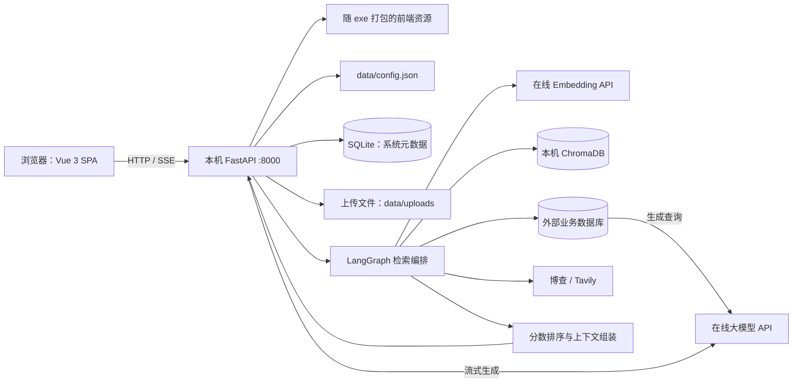
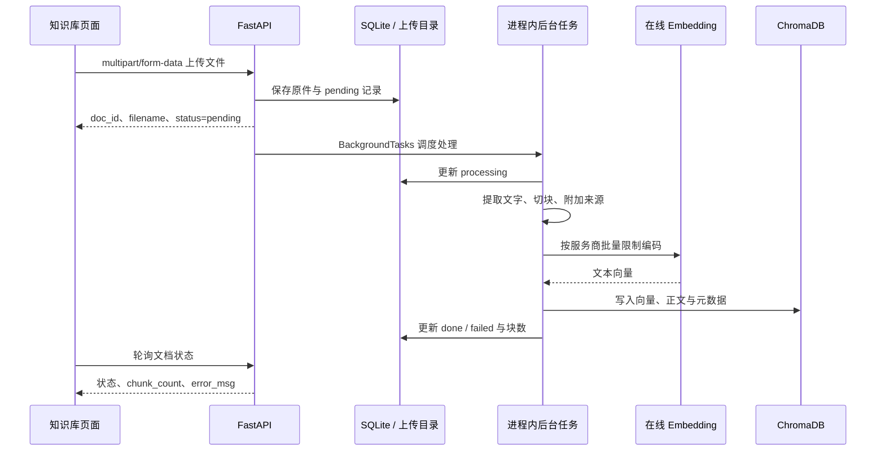
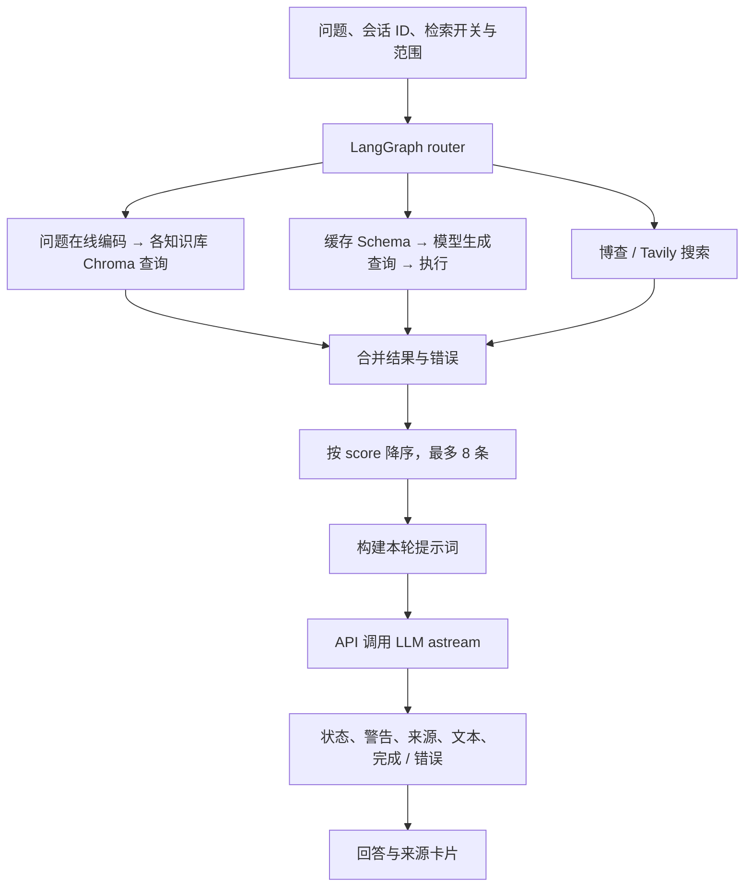

# EnterpriseRag · V2

面向个人与中小团队的企业知识库问答系统，使用 Vue 3、FastAPI、LangGraph、嵌入式 ChromaDB 和在线模型 API。

**V2 定位：以 Windows 单文件程序交付的本机知识检索与问答工具。** 用户运行打包后的 `启动RAG系统.exe`，通过浏览器完成初始化、上传资料和提问；无需安装 Docker、Python、Node.js 或本地模型。开发与打包环境仍需 Python 3.11 和 Node.js 18+，模型、Embedding 与联网搜索需要访问所配置的外部 API。

本版沿用 V1 的技术组成、整体技术路线、主要数据流、部署与验证等文档结构。

当前真实服务验证覆盖纯模型流式回答与本地向量查询；真实知识库问答曾因查询 Embedding API 连接超时未完成，外部业务数据库尚未实测。验证范围与证据见[验证](#验证)，功能边界见[已知限制](#已知限制)。

## V1 与 V2 的差异

### 设计理念与适用场景

从两版架构与交付方式看，V1 更侧重将企业资料检索的主要组件部署在本地：通过 Docker 组织服务，使用本地 BGE 完成编码与精排，使用独立 Qdrant 管理向量。它让维护者能够直接管理模型权重、检索计算与服务配置，同时要求维护者承担容器、模型下载、资源分配和服务连通等工作。V1 的回答生成和联网搜索仍可能调用外部 API，并非完整离线方案。

V2 将重点转向个人和缺少专职 IT 维护的小团队：把页面、后端与嵌入式向量库存入一个交付程序，用初始化向导代替手工配置，把模型计算交给在线 API。用户主要管理资料、账号和服务凭据，安装时无需准备容器和模型权重。相应地，文档入库和问题编码也依赖网络与服务商，API 连通性、额度和数据处理边界成为使用前提。

| 设计维度 | V1 的侧重 | V2 的侧重与取舍 |
| --- | --- | --- |
| 交付对象 | 能管理 Docker 与本地模型的部署维护者 | 希望双击运行、通过页面完成配置的最终用户 |
| 部署目标 | 将前端、API、向量库等服务分别组织并运行 | 减少用户需要安装、启动和排查的组件数量 |
| 计算方式 | 编码与精排占用本机 CPU / 内存，模型权重在本地维护 | 编码与生成走 API，降低本地模型计算负担，增加网络与服务商依赖 |
| 操作方式 | 通过 `.env`、Compose 和维护命令管理部署 | 通过四步向导和管理页面完成常用配置 |
| 数据控制 | 文档编码和候选精排在本机完成；远程生成仍需发送相关资料 | 原件、元数据与向量本地落盘；文档分块与查询文本还需发送给 Embedding 服务 |
| 运维方式 | 检查多个服务、容器日志、模型路径及持久化卷 | 检查一个应用进程、同级数据目录、文件日志及 API 连接 |
| 适用场景 | 愿意维护本地检索组件、关注编码与精排过程控制的部署 | 单机使用、快速试用、少量人员维护的资料问答工具 |

这里的适用场景来自现有架构边界，不代表容量或并发能力的验收结论。两版都没有据此完成大规模、多租户或高可用部署验证。

### 架构与实现变化

| 项目 | V1 | V2 |
| --- | --- | --- |
| 交付方式 | Docker Compose，多容器与 Nginx 入口 | PyInstaller 单文件，FastAPI 同时托管页面与 API |
| 向量存储 | 独立 Qdrant 服务 | 进程内 ChromaDB，落盘至 `data/chroma/` |
| 文本编码 | 本地 BGE-M3 | 智谱 / 通义在线 Embedding API |
| 候选排序 | 本地 BGE reranker | 按各检索结果的 `score` 排序，最多保留 8 条 |
| 模型适配 | ChatLiteLLM / LiteLLM | `langchain_openai.ChatOpenAI` 直连兼容接口 |
| 初始化 | `.env` 与初始账号配置 | 浏览器四步向导，配置保存到 `data/config.json` |
| 联网搜索 | Tavily | 博查 / Tavily |

### 使用体验、质量与成本的变化

- **安装与更新**：V1 需要准备容器环境和本地模型；V2 用户拿到交付包即可启动，配置在浏览器完成。更新时替换 exe 并保留同级 `data/`，维护者仍需在 Windows 开发环境中构建和验证交付包。
- **资源与费用**：V2 省去了本地 BGE 权重的下载、加载和推理负担，但向量索引、文档解析和存储仍消耗本机资源；文档编码、查询编码和回答生成可能分别产生 API 费用。两版总成本没有统一测量，不能仅凭安装简化判断成本更低。
- **检索质量**：V1 使用独立 BGE reranker 对候选相关性重新评分；V2 直接按各分支自带的 `score` 排序并截取上下文。该变化减少了模型依赖，也失去了独立精排步骤；不同来源的分数未校准，目前没有同一数据集上的质量对比，不能宣称 V2 的检索效果优于 V1。
- **可用性反馈**：V2 增加了初始化流程、聊天阶段状态、等待心跳、部分检索失败警告、超时处理和启动日志，便于用户判断当前状态。错误反馈更清晰不等于外部依赖更稳定，真实 Embedding 连通性仍需验证。
- **访问方式**：V1 通过 Nginx 入口访问容器服务；V2 默认绑定 `127.0.0.1`，以本机浏览器使用为主。单文件交付没有同时提供局域网共享、公网部署或多机扩展能力。

### 沿用的能力与升级边界

两版都围绕“文档入库 → 多源检索 → 整理资料 → 模型流式回答”展开，沿用 Vue 3 页面、FastAPI 接口、LangGraph 编排、SQLite 元数据、来源卡片，以及知识库 / 数据库 / 联网检索的基本组织方式。V2 的主要调整集中在交付、依赖与配置体验。

升级时需要关注以下边界：

1. **配置与索引需迁移或重建**：V1 的 `.env` 和 Qdrant 数据不能直接作为 V2 的运行配置或 Chroma 索引使用；没有自动迁移工具，应保留旧版备份，在 V2 重新配置并导入原始文档。
2. **数据外发范围发生变化**：V2 的在线 Embedding 会接收文档分块和查询文本。对编码过程必须本地完成的资料，当前 V2 架构不满足这一要求。
3. **功能延续需要重新验证**：保留数据库问答等功能入口，不代表继承了 V1 的全部安全检查或兼容性结论。V2 当前的数据库执行限制、删除清理和并发处理边界以代码及本文“已知限制”为准。
4. **版本号不代表所有能力增强**：聊天持久化、多轮记忆、细粒度数据权限、后台任务恢复等能力仍未实现；V2 的安装简化与架构调整也不能替代完整业务验收。

## 技术组成

| 组件 | 技术与职责 |
| --- | --- |
| 页面与状态 | Vue 3、Vite、Pinia、Vue Router；初始化、登录、聊天、知识库与管理页面 |
| 后端与入口 | Python 3.11、FastAPI、Uvicorn；默认监听 `127.0.0.1:8000` |
| 系统数据 | SQLAlchemy + SQLite；用户、模型配置、数据库连接、知识库与文档状态 |
| 向量数据 | ChromaDB 0.5；每个知识库独立 collection，余弦距离检索 |
| 文本编码 | 智谱 `embedding-3` / 通义 `text-embedding-v3`，通过 HTTP 调用 |
| 生成模型 | 智谱、通义千问、DeepSeek、豆包、月之暗面；ChatOpenAI 适配 |
| 检索编排 | LangGraph；知识库、业务数据库、联网搜索分支与上下文组装 |
| 联网搜索 | 博查 / Tavily；返回网页内容、标题与 URL 来源 |
| 文档解析 | pdfplumber、python-docx、openpyxl；中文文本切块 |
| 页面通信 | Axios 处理普通请求；Fetch + ReadableStream 接收 POST SSE |
| 认证与凭据 | JWT、bcrypt、AES-256-GCM |
| 打包与日志 | PyInstaller 单文件；控制台与 `data/logs/` 文件日志 |

依赖版本以 [backend/requirements.txt](backend/requirements.txt) 和 [frontend/package-lock.json](frontend/package-lock.json) 为准。默认模型名是代码内置的初始值，实际填写的模型或接入点 ID 应以服务商账号可用配置为准。

## 整体技术路线

V2 采用“浏览器单页应用 → 本机 FastAPI → 检索编排 → 本地存储 / 外部 API”的结构。页面资源随 exe 打包，运行时由后端托管；文档解析、切块和向量索引在本机执行，文本编码与回答生成通过远程服务完成。



### 分层职责与关键选型

| 层次 | 当前实现 | 作用与边界 |
| --- | --- | --- |
| 页面与路由 | Vue Router + Pinia | 页面跳转、检索范围选择、会话与登录状态管理 |
| 回答展示 | Markdown-it、Highlight.js、DOMPurify | Markdown、代码高亮与 HTML 净化；来源卡片独立展示 |
| API | FastAPI、Pydantic | 请求校验、认证、管理操作、文件上传及 SSE 输出 |
| 系统存储 | SQLite + SQLAlchemy | 保存元数据；不保存聊天消息 |
| 配置存储 | ConfigManager | 读写 JSON，首次自动生成签名及加密密钥 |
| 文档流水线 | loader → splitter → embedder | 提取文本、补来源元数据、分批编码与入库 |
| 向量索引 | ChromaDB PersistentClient | 本地持久化；显式传入远程 API 生成的向量 |
| 检索流程 | LangGraph | 按开关执行分支，合并结果及错误，排序后构建提示词 |
| 模型调用 | ChatOpenAI | 指定模型配置优先，否则使用默认配置；无配置时明确报错 |
| 业务数据库 | SQLAlchemy 驱动 / PyMongo | 用模型生成查询，执行后转为检索资料 |

当前没有本地 BGE 编码或神经网络精排模型，也没有独立向量数据库进程。`rerank_node` 只是按结果自带的分数排序截断；不同检索来源的分数未做统一校准。

### 部署与持久化边界

打包运行时，用户数据固定在 **exe 所在目录的 `data/`**，前端资源从 PyInstaller 临时解压目录读取。源码运行时，`data/` 固定在项目根目录，不随启动工作目录改变。

| 数据 | 位置 | 生命周期与用途 |
| --- | --- | --- |
| 初始化状态与密钥 | `data/config.json` | 保存 `initialized`、JWT 签名密钥、凭据加密密钥以及 Embedding / 搜索配置 |
| 系统元数据 | `data/rag_system.db` | 用户、模型配置、数据库连接、知识库、文档记录 |
| 上传原件 | `data/uploads/` | 解析文档的源文件；删除知识库或文档目前不保证同步清理原件 |
| 向量、正文与来源 | `data/chroma/` | 每个知识库的向量与分块数据 |
| 应用日志 | `data/logs/app.log` | 应用运行与文档处理日志；单文件 5 MiB，最多 3 个轮转备份 |
| 打包入口日志 | `data/logs/startup.log` | exe 入口记录的启动异常 |
| 登录状态 | 浏览器 localStorage + Pinia | 保存 JWT 和用户信息；服务端逐请求校验账号 |
| 聊天消息与来源 | 浏览器 Pinia 内存 | 刷新后丢失，未写入服务端数据库 |

API Key 和数据库连接串使用 AES-256-GCM 加密，密码使用 bcrypt 哈希；加密密钥本身保存在 `config.json`，因此需要保护整个数据目录的访问权限。不要单独删除或重新生成密钥，否则已有加密凭据将无法解密。

备份时先停止程序，再整体复制 `data/`。SQLite、原文件和 ChromaDB 之间没有跨存储事务。V1 的 Qdrant 索引、`.env` 与 V2 数据格式没有自动迁移流程，不能直接作为 V2 配置或向量索引使用。

## 主要数据流

### 1. 初始化、登录与管理操作

1. 浏览器检查 `GET /api/v1/setup/status`。未初始化时进入四步向导：设置管理员密码 → 配置大模型 → 配置 Embedding → 可选配置搜索。
2. 管理员用户名固定为 `admin`，向导要求密码至少 8 位。大模型步骤提供实际连接测试；搜索可以跳过。
3. 配置写入本地 JSON / SQLite，凭据加密保存；完成向导后设置 `initialized=true`。后端在初始化前拦截业务 API，保留 Setup 与健康检查入口。
4. 登录通过 `POST /api/v1/auth/login` 发送 JSON 用户名和密码，成功后返回 JWT，默认有效期 480 分钟。
5. 后续普通请求与 SSE 请求携带 `Authorization: Bearer ...`。后端检查令牌、账号存在性与启用状态；管理操作使用管理员权限依赖。
6. 管理员可新增和测试模型、设默认模型、维护数据库连接、刷新 Schema、管理用户，以及修改 Embedding 和搜索配置。

模型管理当前提供五家服务商预设。大模型配置保存在 SQLite；Embedding 和搜索配置保存在 `config.json`，修改 `.env` 不会更改这些运行配置。更换 Embedding 服务商或模型后，应重新建立文档向量，不能假定旧索引与新向量兼容。

### 2. 文件上传、解析与向量入库



- 支持提取 PDF、DOCX、XLSX、TXT、Markdown 文本，默认文件大小上限 50 MiB。旧 `.xls` 文件应先转为 `.xlsx`；当前解析器使用 openpyxl，不支持旧二进制 Excel 格式。
- PDF 提取可复制文本，没有 OCR；DOCX 读取段落，XLSX 按工作表读取单元格。TXT / Markdown 按 UTF-8 读取。
- 默认每块 512 个字符，重叠 64 个字符，按换行和中文标点等切分；单位是字符而非 token。
- 每块携带 `kb_id`、`doc_id`、`filename`、`page`；PDF 的页码对应原页，Excel 的页号对应工作表序号，其他格式通常为 1。
- Embedding 客户端按服务商限制分批请求，Chroma collection 使用余弦距离，向量维度取决于所选模型。
- 状态为 `pending → processing → done`，失败为 `failed` 并记录原因。上传成功只表示接收成功，需查看最终状态和块数；解析不出文字时可能显示 `done` 但块数为 0。

后台任务运行在应用进程内，没有独立队列、持久化调度或中断恢复。删除文档会按 `doc_id` 清理向量与元数据，删除知识库会清理 collection 和文档记录；原文件清理及跨存储一致性仍有局限，见[已知限制](#已知限制)。

### 3. 提问、多路检索与回答



聊天入口为 `POST /api/v1/chat/stream`，请求示例：

```json
{
  "session_id": "browser-session-id",
  "query": "公司的报销流程是什么？",
  "scope_vector": true,
  "scope_database": false,
  "scope_web": false,
  "knowledge_ids": [],
  "db_connection_ids": [],
  "llm_config_id": null
}
```

`knowledge_ids=[]` 表示全部知识库，`db_connection_ids=[]` 表示全部活跃业务连接，实际是否执行仍受对应开关控制。聊天页提供范围开关及知识库 / 数据库多选；关闭三个检索开关后可直接进行纯模型对话。

1. 请求指定模型配置时使用该配置，否则读取数据库默认配置，没有 `.env` 模型回退。
2. 知识库分支先检查索引是否为空，再用在线 Embedding 对问题编码一次，对每个目标知识库取最多 5 条候选。Chroma 同步操作放在线程中执行。
3. 分支结果统一携带正文、来源类型、名称、详情和分数，并追加合并。无可用资料且存在检索错误时返回 `error`；有可用资料时发送 `warning`，继续使用成功分支生成回答。
4. 候选按 `score` 降序排列，最多保留 8 条。生成节点只构建提示词，实际模型流式调用在聊天 API 中执行。
5. API 先推送阶段状态，再推送来源和文本增量。检索超时为 35 秒，等待下一段模型输出最多 45 秒，生成循环检查对话总时限 180 秒；等待期间约每 5 秒发送心跳。
6. 前端将回答追加到独立 assistant 消息，展示 Markdown 与来源卡片；支持停止接收，离开聊天页时中止当前请求。

当前上下文只有**本轮问题与本轮检索结果**，没有服务端多轮记忆。远程 Embedding 会接收文档分块及查询文本；大模型会接收问题与选中的资料，数据库分支还会发送结构信息。数据本地落盘不代表全流程离线处理。

### 4. 业务数据库与联网检索

数据库分支读取连接记录和缓存的 `schema_cache`，交给模型生成查询；新增连接后应先测试连接并刷新 Schema，表结构变动后也需刷新。

| 数据源 | 当前路径与边界 |
| --- | --- |
| MySQL / PostgreSQL / MSSQL / Oracle | 由模型生成 SQL，当前检查以 `SELECT` 开头，最多取 50 行 |
| MongoDB | 模型输出 `collection`、`filter`、`projection` JSON，通过 `find` 查询，最多取 50 条 |
| 回答上下文 | 每个数据库分支结果最多取前 10 行转为 JSON 文本 |
| 连接与查询 | 异步等待模型，数据库 I/O 在线程中执行，并设置连接 / 查询超时 |
| 联网搜索 | 使用配置的博查或 Tavily，把网页结果转为相同来源结构 |

`blocked_tables` 在结构读取时过滤，但当前执行阶段没有完整的表 / 集合访问检查；SQL 前缀检查也不是完整的只读安全校验。应使用数据库端只读账号，并在数据库端限制可访问的数据。MSSQL 还需要本机安装与连接串匹配的 ODBC Driver，Python 包本身不包含系统驱动。所有外部业务数据库的实际连通性与方言兼容性仍需单独验证。

### 5. HTTP 契约与 SSE 数据回传

| 场景 | 请求约定 | 返回与前端处理 |
| --- | --- | --- |
| 初始化、登录、聊天、创建模型 / 连接 / 用户 | JSON 请求体 | Pydantic 校验，参数错误通常返回 422 |
| 创建知识库 | JSON `name`、`description` | 返回知识库记录 |
| 文件上传 | multipart，字段名 `file` | 先返回 pending，随后轮询文档列表 |
| 模型连接测试 | POST JSON，管理接口使用 `config_id` | 实际调用模型并返回结果 |
| 列表与资源操作 | GET / PUT / DELETE + 资源 ID | 返回记录或错误信息；管理接口要求 admin |
| 聊天输出 | 带 Bearer 令牌的 POST，响应为 `text/event-stream` | Fetch 解析状态、警告、来源、文本与终止事件 |

SSE 使用 `data:` 行承载 JSON，事件名位于 JSON 的 `event` 字段；不是独立的 SSE `event:` 行。每帧以空行结束：

```text
data: {"event":"status","data":"正在检索资料"}

: heartbeat

data: {"event":"source","data":{"source_type":"vector","source_name":"报销制度.txt","source_detail":"第1页","text":"相关片段","score":0.9}}

data: {"event":"token","data":"报销时请提交相关凭证。"}

data: {"event":"done","data":{"total_tokens":11}}

```

`status` 表示阶段，`warning` 表示部分检索失败，`source` 与 `token` 可多次出现，`done` 或 `error` 表示终止；心跳是注释帧。HTTP 200 不代表回答完成，仍需检查流内终止事件。`token` 是文本增量，`done.data.total_tokens` 实际按回答字符数累计，不能用于模型计费统计。

前端处理 UTF-8 分片、CRLF、流尾残留、结构化错误、异常断流与取消；默认 60 秒没有收到数据则中止等待。接口设置 `Cache-Control: no-cache` 与 `X-Accel-Buffering: no`。如自行增加反向代理，需要配置 SSE 转发与超时。

关键入口：[初始化 API](backend/app/api/setup.py)、[聊天 API](backend/app/api/chat.py)、[检索图](backend/app/agents/graph.py)、[文档流水线](backend/app/pipeline/embedder.py)、[向量存储](backend/app/vectorstore/chroma_store.py)、[模型工厂](backend/app/models/llm_factory.py)、[SSE 客户端](frontend/src/utils/sse.js)。

## 项目目录

```text
EnterpriseRag/
├── backend/
│   ├── app/
│   │   ├── api/                 # Setup、认证、聊天、知识库、管理
│   │   ├── agents/              # 检索分支、结果排序、提示词构建
│   │   ├── connectors/          # SQL / MongoDB 连接器
│   │   ├── core/                # 配置、路径、认证、加密、日志与重试
│   │   ├── db/                  # SQLite ORM 与 CRUD
│   │   ├── models/              # LLM 工厂与在线 Embedding 客户端
│   │   ├── pipeline/            # 文档解析、切块与入库
│   │   ├── search/              # 博查 / Tavily
│   │   └── vectorstore/         # ChromaDB 封装
│   ├── scripts/                # 打包与诊断脚本
│   ├── tests/                  # 后端自动化测试
│   ├── resources/              # 可选 icon.ico
│   ├── launcher.py             # exe 入口、启动自检与错误保留
│   ├── rag_system.spec         # PyInstaller 配置
│   └── requirements.txt
├── frontend/
│   ├── src/                    # 页面、组件、状态、API 与工具
│   └── tests/                  # Node.js 自动化测试
├── docs/testing/               # 已有验证记录
├── data/                       # 源码运行时数据，自动生成
├── release/                    # 根目录脚本生成的交付包
├── start_uv.bat
├── start_python.bat
├── build_release_uv.bat
├── build_release_python.bat
├── 配置说明.txt
└── README.md
```

`data/`、`release/` 及构建产物是运行或生成目录，不用于存放源码。V2 启动不依赖 `.env`、Nginx、Docker Compose 或本地 BGE 模型目录。

## 快速部署

### 1. 最终用户：运行交付包

1. 将交付包放到有写入权限的本机目录，双击 `启动RAG系统.exe`。
2. 等待浏览器打开；未自动打开时访问 `http://127.0.0.1:8000`。
3. 按向导设置管理员密码、模型 API Key、Embedding API Key，并按需配置搜索。
4. 用 `admin` 和刚设置的密码登录。关闭控制台窗口即可停止程序。

用户运行交付包无需安装开发工具，但需要可访问模型与 Embedding 服务，所用 API 的授权、余额和调用限制由服务商管理。交付说明见 [配置说明.txt](配置说明.txt)。

### 2. 开发者：源码启动

需要 Node.js 18+，以及以下两种后端环境之一：已安装的 uv（脚本按需准备 Python 3.11），或已安装 Python 3.11 + pip（加入 PATH 或使用 Python Launcher）。从项目根目录运行：

| 脚本 | 用途 |
| --- | --- |
| `start_uv.bat` | uv 创建环境、安装依赖，启动后端与 Vite |
| `start_python.bat` | Python / pip 创建环境、安装依赖，启动后端与 Vite |
| `build_release_uv.bat` | uv 准备环境、构建并打包至 `release/` |
| `build_release_python.bat` | Python / pip 准备环境、构建并打包至 `release/` |

四个脚本共用 `backend/.venv`，要求该环境为 Python 3.11；首次安装依赖需要联网。源码启动会打开前后端两个窗口，浏览器访问 `http://localhost:5173`，Vite 将 `/api` 代理到 `127.0.0.1:8000`。默认端口 8000 和 5173 需可用，停止时关闭对应窗口。

也可手动启动，以下均为 Windows PowerShell 命令。后端窗口从项目根目录执行：

```powershell
py -3.11 -m venv backend/.venv
& ./backend/.venv/Scripts/python.exe -m pip install -r backend/requirements.txt
Set-Location backend
& ./.venv/Scripts/python.exe -m uvicorn app.main:app --host 127.0.0.1 --port 8000
```

另开前端窗口，从项目根目录执行：

```powershell
Set-Location frontend
npm install
npm run dev -- --host localhost --port 5173 --strictPort --open
```

### 3. 开发者：构建交付包

在 Windows 上运行 `build_release_uv.bat` 或 `build_release_python.bat`，生成目录为 `release/`。也可在已准备好的后端环境下，从项目根目录执行：

```powershell
& ./backend/.venv/Scripts/python.exe backend/scripts/build_exe.py --output-dir ./release
```

脚本会安装前端依赖并构建页面、复制资源、调用 PyInstaller、运行真实 exe 的启动自检，再整理交付文件。`backend/resources/icon.ico` 可选，缺省使用默认图标；`配置说明.txt` 会复制进交付包，项目根目录若存在 `使用手册.pdf` 也会复制，缺少手册仅打印提示。

不传 `--output-dir` 时，打包脚本仍默认输出到 `build/企业RAG系统_v1.0/`；这是尚未调整的脚本目录名，本 README 将当前产品版本统一标记为 V2。Windows exe 应在 Windows 环境构建。

更新前先关闭旧程序并备份整个 `data/`，再替换可执行文件。保留同级数据目录及原密钥；V1 升级需要另外规划配置迁移和文档重新入库。

## 使用流程

1. 完成初始化并登录，在管理页测试默认大模型连接。
2. 在“知识库”创建库，上传文档，等待处理结束，确认状态为 `done` 且块数大于 0。
3. 在聊天页选择模型，勾选知识库并选择范围，提问后查看回答及来源卡片。
4. 需要联网资料时，先配置博查 / Tavily，再开启联网搜索。
5. 需要业务数据时，由管理员添加数据库连接，测试并刷新 Schema，再开启数据库检索。
6. 排查模型连接时可先关闭全部检索开关；纯模型对话成功不代表 Embedding 或业务数据库已经可用。

## 常用维护命令

以下在项目根目录的 PowerShell 中运行。源码运行的数据位于根目录 `data/`；打包运行时应切换到 exe 所在目录查看对应数据。

```powershell
# 查看最近的应用日志
Get-Content ./data/logs/app.log -Tail 100

# 查看打包程序的启动错误
Get-Content ./release/data/logs/startup.log -Tail 100

# 检查已运行的后端
Invoke-RestMethod http://127.0.0.1:8000/api/health

# 使用其他端口运行打包程序
& ./release/启动RAG系统.exe --port 8001 --no-browser

# 检查打包依赖和临时向量库，完成后退出
& ./release/启动RAG系统.exe --check-startup
```

`--check-startup` 检查 API 导入、检索图及临时 Chroma 写入 / 查询，不测试外部 API，也不代表完整业务验收。源码环境可在 `backend/` 下用 `python -m scripts.check_local_vectors` 检查已有索引与文档记录；该脚本会打开向量库，缺失的 collection 可能被创建，不用于备份期间的离线只读审计。

## 验证

### 已有验证证据

[2026-10-30 可用性验证记录](docs/testing/usability-verification-2026-10-30.json) 记载了以下结果，属于此前验证记录，本次 README 整理没有重新执行这些业务测试：

| 范围 | 记录结果与边界 |
| --- | --- |
| 自动化与构建 | 后端 28 项、前端 9 项通过，前端构建通过 |
| API 与页面 | 健康检查、登录态用户信息、知识库列表、管理员用户列表，以及静态页面路由检查通过 |
| 真实纯模型对话 | 通过前端代理调用配置的 DeepSeek，收到 `status / token / done` |
| 本地 Chroma 查询 | 已有非空 collection 查询成功；不依赖在线查询编码 |
| 真实知识库回答 | 未通过完整链路；查询 Embedding API 连接超时，收到 `status / error` |
| 遗留索引 | 发现文档记录存在但 Chroma collection 为空的历史不一致，需要恢复连接后重建 |
| 外部业务数据库 | 未执行真实数据库验收 |

集成测试中的部分云端 I/O 使用替身，覆盖真实 API、SQLite、Chroma 和文档流水线；这类测试不能代替真实服务连通性检查。已有记录还保留 Starlette / AnyIO ResourceWarning、Vite CJS 与包体积警告，未将其表述为已修复。

### 重新验证命令

后端在 `backend/` 目录执行：

```powershell
& ./.venv/Scripts/python.exe -m unittest discover -s tests -p 'test_*.py' -v
```

前端在 `frontend/` 目录执行：

```powershell
node --test tests/chat-lifecycle.test.mjs tests/knowledge-status-polling.test.mjs tests/sse-reliability.test.mjs
npm run build
```

真实服务验证需先完成初始化并启动前后端，在 `backend/` 运行 `python -m scripts.verify_live`；会调用当前配置的模型与 Embedding，并写入验证报告，可能产生 API 费用。打包 HTTP 检查可从项目根目录执行：

```powershell
& ./backend/.venv/Scripts/python.exe backend/scripts/verify_packaged.py ./release/启动RAG系统.exe
```

该脚本使用临时端口启动实际 exe、检查健康与页面路由，再停止本次启动的进程树；会使用交付目录下的数据路径，不验证全部业务操作。

## 常见问题

**双击后无法启动或窗口退出？**

先查看 exe 同级的 `data/logs/startup.log` 与 `data/logs/app.log`，确认目录可写、8000 端口未占用。入口会尽量保留异常并等待确认；也可在 PowerShell 中运行 exe 查看输出。

**浏览器没有打开，或页面地址打不开？**

手动访问控制台显示的地址，默认是 `http://127.0.0.1:8000`。源码开发使用 `http://localhost:5173`，需要前后端都在运行；使用 `--port` 后应访问相应端口。

**初始化后仍跳回向导？**

确认启动的是原来的 exe 或源码目录，并检查该目录下的 `data/config.json` 是否完整。复制 exe 到新位置不会自动携带旧数据；应恢复配套的整个 `data/`，不要通过删除数据目录或强行修改初始化标志绕过问题。

**模型可以对话，知识库却检索失败？**

大模型与 Embedding 是两套独立配置。检查 Embedding 的 API Key、模型名、服务区域及网络连接，再检查文档块数与索引。服务商标识 `qwen` / `zhipu` 不是模型名；留空可使用代码默认模型。

**文档显示完成，但没有可检索内容？**

检查块数。扫描 PDF 或空文档可能产生 0 块；有文档记录也不保证向量索引完整。先恢复 Embedding 连接，再对缺失索引的文档重新入库；目前没有通用的一键修复或自动恢复机制。

**如何更换模型或重新配置搜索？**

在“管理 → 模型配置”新增并测试模型，设置默认；Embedding / 搜索在“系统设置”修改。换用不同 Embedding 模型后需重建对应索引。

**更新程序后凭据解密失败？**

检查是否保留了原 `data/config.json` 及加密密钥。只有数据库而没有原密钥无法解密旧凭据，应从完整备份恢复，或重新录入凭据。

## 已知限制

- 当前交付面向本机 Windows 使用，默认仅监听回环地址；未提供多机共享部署、HTTPS 或公网访问配置。
- V2 不支持全流程离线使用。Embedding、模型及搜索依赖外部 API，真实知识库问答的既有验证仍受 Embedding 连接超时阻碍。
- 聊天记录只存在浏览器内存，没有持久化、多轮上下文或跨设备会话恢复。
- 文档处理为进程内后台任务，重启后不会自动恢复；没有 OCR、通用索引重建接口或跨存储事务。
- 删除文档 / 知识库没有完整原件清理，知识库删除对 collection 清理异常也未完整暴露；并发删除、入库中断和失败恢复仍需完善。
- 只有 admin / user 角色，知识库接口按登录态开放，没有按用户或租户隔离知识库的数据权限。
- SQL 仅有 `SELECT` 前缀检查，禁用表 / 集合未在执行阶段完整强制校验，不能作为安全沙箱；外部数据库实测仍待完成。
- 多路结果仅按原始分数排序，没有独立 reranker、跨来源分数校准或大规模性能验收。
- V1 配置与 Qdrant 索引没有自动迁移；部分源码注释和打包默认目录仍保留历史版本名，不代表本版产品编号。

## 版本记录

| 版本 | 内容 |
| --- | --- |
| V2（当前） | Windows 单文件交付、浏览器初始化向导、ChromaDB 本地存储、在线 Embedding、国内模型直连、博查 / Tavily、SSE 状态与心跳、日志和打包自检 |
| V1 | Docker / Nginx / Qdrant 部署、本地 BGE 编码与精排、基础知识库与多源问答 |
