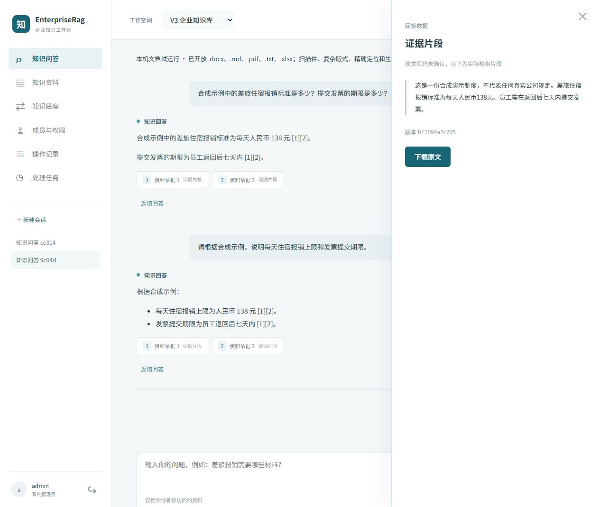

# V3 本机可用版本报告

验证日期：2026-10-30。结论：当前机器可进行文档上传、处理、发布、问答、原文核对及管理员底座切换。它是有明确范围的本机试运行版本，完整企业生产验收尚未完成。较早的失败和替身诊断报告保留，不代表当前运行状态。

后续独立复查发现的租约异常和失败草稿切换缺陷已修复，最新回归为 59 项后端、2 项前端通过；真实取消恢复后的双向切换也已通过，详见 [修复验证](../fixes-2026-10-30.md)。

## 直接使用

1. 打开 http://127.0.0.1:18000/，选择“V3 企业知识库”。当前模型、WeKnora、Dify 和业务知识库已配置，无需重新登记底座。开发登录令牌在私有 `v3.local` 的 `V3_BOOTSTRAP_TOKEN`，不要公开该文件。
2. 在“知识资料”上传 TXT、Markdown、基础 DOCX／XLSX 或文字 PDF。等待任务处理至 ready 后发布，未发布草稿不会进入普通问答。
3. 在“知识问答”提问，点击资料依据核对片段／下载原文。现有“使用示例-合成差旅制度.txt”是合成测试资料，可询问住宿报销标准与发票期限；应回答每天 138 元、返回后七天内。
4. 如需切换，进入“知识底座”，选择目标，准备同步，待就绪后启用。不是未预热的自动故障切换。当前默认使用 WeKnora。

重载应用配置：在仓库根目录 PowerShell 执行 `& .\tools\v3\start_local.ps1 -Restart`。脚本重启 API 和 Worker；Docker Desktop、PostgreSQL 和选用平台须保持运行。日志在 `data-v3/logs`。不要删除 Docker 数据卷。

## 实际验证结果

| 项目 | 结果及证据 |
| --- | --- |
| 真实云端模型 | `qwen3.8-flash` 回答、`qwen3.7-text-rerank` 精排、`qwen3.7-text-embedding-flash` 向量均实际成功；向量维度为 1024 |
| 后端回归 | 59 项通过、无跳过，含真实 PostgreSQL 并发、授权、历史、任务、版本、切换、生产模式拒绝本机资格、格式证据绑定及失败草稿取消。启用脚本仅在全部通过且无跳过时生成报告 |
| 前端与构建 | 2 项前端测试通过，Vite 构建及 Linux 应用镜像构建通过 |
| WeKnora | 真实入库，受限向量／关键词／混合召回；只读密钥拒绝上传、范围外知识库访问被拒绝 |
| Dify | 真实高质量向量索引、受限语义／全文召回、元数据回读；范围外知识库访问被拒绝 |
| 双底座业务 | 使用隔离业务测试库与真实平台完成 WeKnora → Dify → WeKnora；草稿切换后发布，新旧答案按发布状态变化 |
| 授权边界 | 无权资料未进入发给模型的请求；撤权后原文拒绝、历史受限；空范围不向底座发送请求 |
| 文件解析 | 两个平台各自 DOCX／XLSX／文字 PDF，六组最小合成文件均处理完成且事实成功召回；报告绑定端点、集合、运行镜像与 Embedding 模型，其他部署的结果不能直接复用 |
| 工作台实际链路 | HTTP 上传 → 后台处理 → 发布 → 流式引用回答 → 历史保存；浏览器登录、回答与引用抽屉实际核对 |

机器证据：[WeKnora](weknora-local-pilot.json)、[Dify](dify-local-pilot.json)、[六组格式探针](format-probes.json)。限定独立复核已确认格式证据上下文绑定问题关闭。

本轮修正了千问精排协议适配、上传幂等判定及切换漏同步草稿的问题；增加受证据约束的格式开放与本机试运行资格。API 和 Worker 已按当前配置重启。

## 具体部署与限制

- WeKnora v0.9.0 固定提交，使用已验证的“开启问题生成”配置。关闭该配置的 ParadeDB 授权检索 SQL 故障没有被宣称修复。
- Dify 1.18.0 使用 `deploy/v3/dify-compat` 的最小租户上下文兼容补丁；官方原始镜像的上传故障仍保留历史记录。安装官方签名 OpenAI API compatible 模型插件，高质量索引。Dify 的数据集范围密钥不具备单独只读权限，三种用途引用不能视为三个权限等级。
- 运行平台镜像 SHA 写在各报告中；更换平台镜像、集合或模型应重新验证。Embedding 模型／维度变化须重新建索引，不能仅改数字继续沿用原向量。
- 本机资格的内部兼容名称为 `local_text_pilot`／`runtime_local_pilot`，现按实际格式证据开放上述五类扩展名；`verified=false`，仅 development 可用，production 拒绝这类资格。
- 格式测试使用最小合成文件，证明基础文字可提取与检索，不代表所有真实 Office／PDF 版式可靠。扫描件 OCR、复杂／跨页表格、精确页码和单元格引用未验收；引用目前为片段级别。
- 完整生产 G0、容量压测、端到端备份恢复、自动对账、原件孤立回收与远端物理清理确认仍需完成。Dify 单次检索问题超过 250 字符会明确失败；路由变更后需要重新提问。
- 当前“开发管理员令牌”不适合企业上线；正式环境须使用企业身份、S3 原件存储和完整生产资格。

复现入口：`tools/v3/verify_document_formats.py`（六组格式探针）、`tools/v3/enable_local_pilot.py`（真实双底座验收与 53 项回归）。它们读取私有 `v3.local` 及本机临时部署状态；不能不经部署就把报告复制到其他环境启用。

