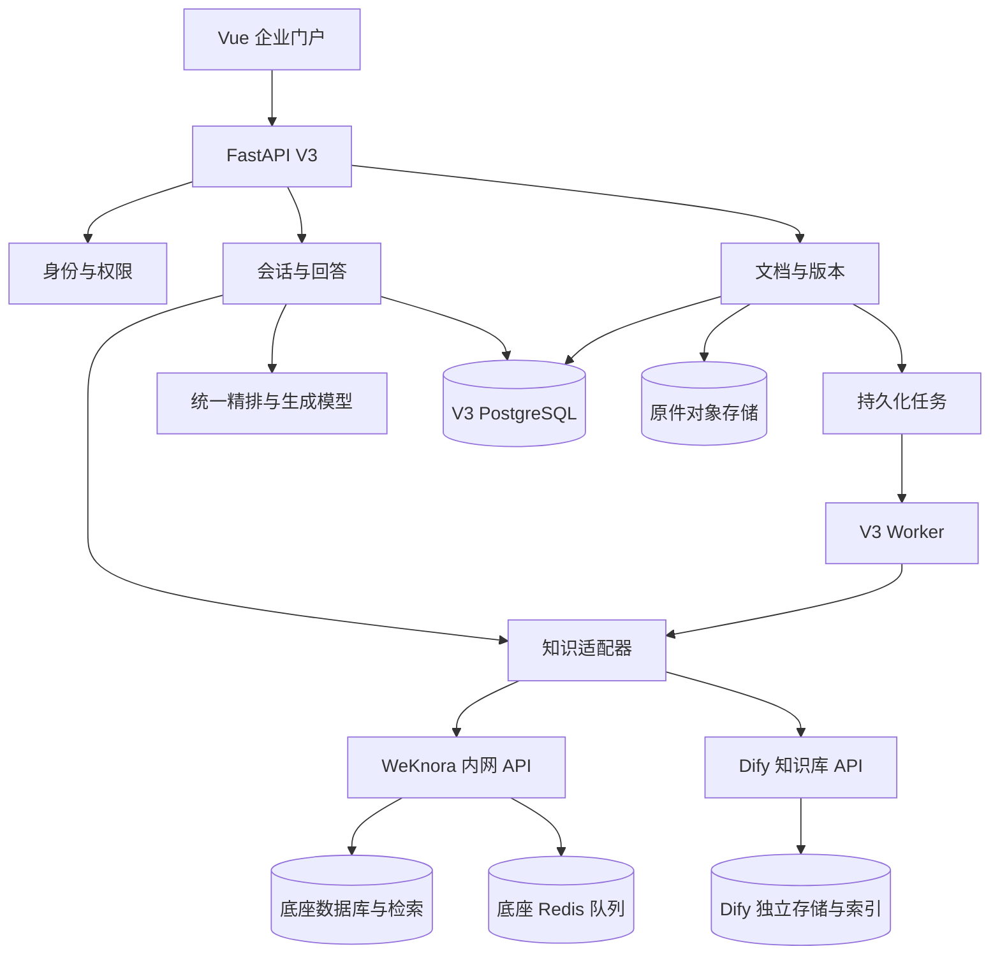

# EnterpriseRag V3 企业知识问答技术设计

## 1. 目标与范围

企业员工通过浏览器查询自己有权访问的企业资料，得到带原文引用的回答。管理员能管理资料版本、处理失败、授权、审计和恢复。本文的技术选择是建议默认值；实际性能和容量由隔离环境测试确定。

首期目标覆盖 PDF、DOCX、XLSX、TXT、Markdown，包含扫描 PDF 的 OCR（把图片中的文字转成可检索文本）。两套底座按格式分别验收；业务空间要求的解析及定位能力不能在切换时静默降级。先接入文件上传，首个外部资料系统按实际业务确定，不能假设已经存在飞书、SharePoint 或企业单点登录。

首期不启用 SQL 问答、联网搜索、Wiki、知识图谱、自主执行或多智能体。回答默认仅基于企业资料，不自动回退为无依据的通用模型回答。

## 2. 方案与现有系统处理

选择“自有业务层 + WeKnora／Dify 两套适配器 + 可管理的底座切换”。Dify 使用独立知识库 API，不绑定其 Chatflow／Workflow。直接把全部业务交给平台会增加迁移约束；全面自建增加通用能力建设。源码证据支持接入路径，运行时采用条件见 [WeKnora 核查](weknora-feasibility.md) 及 [双底座设计与 Dify 核查](dual-backend.md)。后者补充的路由、同步水位和能力约束是首版要求。

当前 V2 继续保持独立运行；V3 在独立配置、数据库、文件存储和部署入口中建设，禁止读取 V2 的运行密钥或直接更新其 SQLite、Chroma 数据。

复用 Vue 3、FastAPI、SSE（服务器持续推送回答片段）、模型接入经验和有效测试素材。业务模型、授权、文档任务、索引映射重新设计。LangGraph 可用于后续复杂分支，首期不作为必要依赖。沿用 Python 后端，不因用户有 .NET 经验而擅自更换语言。

## 3. 系统职责与部署



| 服务 | 职责与边界 |
| --- | --- |
| Vue 门户 | 资料管理、会话、引用、反馈；不持有底座密钥 |
| V3 API | 所有员工请求入口，授权、版本发布、会话和审计 |
| V3 PostgreSQL | 用户映射、授权、版本、索引映射、会话、业务任务；与平台数据库分离 |
| 原件对象存储 | 不可变原件、版本和备份；平台只持处理副本，删除平台副本不删除主原件 |
| V3 Worker | 可靠提交、轮询、对账、业务重试；不重复实现底座内部解析队列 |
| WeKnora 标准版 | 解析、分块、Embedding、索引和受限召回；只开放给内部服务 |
| Dify 知识服务 | 另一套解析、索引与受限召回；独立部署和数据映射，不直接对用户生成答案 |
| 模型服务模块 | 最终精排与生成，设置限流、超时、凭据、模型版本及审计；先做应用内模块 |

业务任务先使用 PostgreSQL 任务表配合 `FOR UPDATE SKIP LOCKED` 领取，避免额外引入第二套队列中间件。Worker 有租约、续约、失败次数和定时对账；这意味着任务可能再次执行，处理必须做到重复执行不产生第二份业务结果。

开发和 G0 使用 Linux Docker Compose，WeKnora 锁定 v0.9.0、Dify 锁定 1.18.0 的已审阅提交构建产物与镜像 digest（镜像内容指纹）。Dify 的解析／模型插件和检索存储一并固定；两平台不共用内部数据库结构。生产建议至少两个 V3 API 实例、独立 Worker、企业托管或受运维管理的数据库与对象存储。底座多实例是否安全以及所需共享文件／临时目录须单独验证；G0 单机部署不能作为高可用验收。是否使用 Kubernetes 由运维平台决定。

WeKnora PostgreSQL 检索先使用其官方组合中的 ParadeDB；Dify 的向量存储独立选择并在 G0 固定验证，不继承 WeKnora 的检索后端结论。V3 业务库可使用普通 PostgreSQL。Redis 必须配置持久化、认证、容量及备份恢复；不承诺仅配置 AOF 就不会丢任务。

## 4. 数据模型和权威来源

所有表包含企业标识 `tenant_id`，所有查询显式带企业条件；首期部署一个企业，但不省略隔离字段。时间使用带时区的 UTC 时间存储，界面按 Asia/Shanghai 显示。

| 表 | 主要字段／约束 |
| --- | --- |
| users / groups / memberships | 企业身份来源、外部用户编号、启用状态、组关系；停用即时阻断访问 |
| knowledge_spaces | 业务知识库编号、企业、负责人、默认授权策略 |
| documents | 稳定文档编号、来源、负责人、删除标记、当前版本指针、授权修订号 |
| document_versions | 文档编号、版本号、SHA-256、原件键、生效区间、发布状态；原件不可变 |
| document_grants | 用户／组、文档或知识库、操作；默认拒绝，显式拒绝优先，不开放首期任意规则表达式 |
| index_generations | 业务版本、底座实例、配置版本、代次、状态；每个平台副本独立记录 |
| backend_bindings | 企业、业务版本、索引代次、平台实例／空间／库／文档 ID、batch_id、v3_binding_id；实例内反向映射唯一且经过归属验证 |
| backend_instances / space_backend_routes | 平台部署、凭据引用、业务知识库的活动底座、路由修订号与所需能力 |
| backend_replica_states / backend_switches | 目标副本状态、同步水位、切换清单、验收报告与执行记录 |
| jobs | 类型、幂等键、状态、下次运行时间、租约 token、次数、远端 ID、错误 |
| conversations / messages | 所有人、状态、内容、模型／提示词版本；失败消息不能标记完成 |
| citations | 消息、业务文档版本、代次、块 ID、定位、证据文本、证据指纹 |
| feedback / audit_events | 反馈、操作者、操作、资源、结果、请求 ID；日志避免保存密钥及不必要正文 |

文档业务版本表示“制度内容变化”；索引代次表示“相同内容换解析器、分块或模型重新建立索引”。两者分开，防止重建索引被误当成制度更新。

同一业务版本、同一索引代次的重复提交采用 SHA-256 和业务幂等键去重。首期禁止不同业务文档、不同业务版本或不同索引代次共用同一平台文档记录，保证返回的平台 ID 能唯一反查权限、版本和引用归属。409 仅在同企业、同业务版本、同代次、同内容和配置且映射唯一时允许认领；其他情况使用独立物理库建立隔离记录，或明确冲突失败。原件对象可按不可变指纹去重，但不能据此共用平台文档映射。

## 5. 授权与并发撤权

RBAC 是“按角色允许哪些操作”，例如资料管理员可维护资料；数据授权决定“允许操作哪些资料”，按用户、组和文档计算。系统管理员管理运行配置，不自动获得全部业务资料阅读权；紧急访问必须另行授权并审计。

`resolve_scope(user_id, requested_space_ids, as_of)` 返回服务端生成的 `AuthorizedScope`，包含企业、用户、授权／目录／路由修订号和允许使用的已发布版本／活动索引映射。客户端只能选择业务知识库编号，不能传入平台空间、平台文档列表、元数据过滤条件或服务凭据。

必须满足：

1. 无权范围返回业务空结果，不调用任何底座；WeKnora 禁止发送空 `knowledge_ids`，Dify 禁止遗漏／清空授权元数据条件，不能将两者解释为全库查询。
2. 根据后端生成的范围发起召回，且每个结果反查业务映射、文档版本和当前授权。意外返回越权结果时整次请求失败并告警，不能当作普通低分结果静默跳过。
3. 召回后、精排前、生成前检查授权修订。每次模型派发和每次 SSE 正文写出，都在同一协调边界中复查：按企业分配唯一数据库协调键，派发／输出事务使用共享 advisory lock（数据库提供的应用协调锁）；撤权、资料发布／撤回和底座路由切换事务使用同键独占锁，再修改相应修订号。共享锁允许并发读取；独占锁保证变更与派发／写出有明确先后。生成派发前在共享锁内同时核验 authz、catalog、route 修订，不能只在锁外读取一次。派发锁只持有到流式请求建立／响应头到达，不能持有到完整生成结束；正文按小批次检查当前授权并写出，发送超时关闭连接。已开始输出的请求可以保留旧目录／路由快照，但不能忽略撤权或撤回，所有应用实例都必须经过相同入口。
4. 已派发给外部模型的内容无法撤回，已显示或已写入传输缓冲区的文本也无法抹除；承诺范围为撤权提交后不再派发新的资料调用、不再向传输层写出新的正文及阻断后续访问。已排队网络数据仍可能随后到达客户端，验收按服务端派发／写出时间判断。外部服务的保存策略须符合资料使用要求。
5. 会话首期仅本人可读。每条消息保存其依赖的全部文档；读取历史和构建多轮上下文时重新授权，任一依据失效则整条相关回答隐藏且不再作为模型上下文。跨用户共享会话另行设计。
6. 原文、引用、图片通过 V3 代理访问，每次检查授权。不向用户返回底座直链、对象存储永久地址或可绕过撤权的长效签名链接。
7. 首期关闭答案和检索共享缓存。以后缓存键必须包含企业、权限修订、文档集合、索引代次和模型配置，撤权立即失效。

底座只作为机器服务。WeKnora 检索凭据限定知识库的 `retrieve`，写入为受限 `ingest`，管理任务使用 `manage_kbs`。Dify 使用数据集范围凭据；不能假设其 API Key 同样具备 retrieve／ingest 分权，首版通过内部方法／路径白名单代理隔离检索调用和写操作，并实测 key 的数据集边界。密钥不下发前端，不使用全空间全权 key 处理员工查询。两者空白名单的语义分别验证。

## 6. 资料入库、发布和重建

业务处理状态：`received → submitting → backend_processing → ready → published`；异常为 `retry_wait / failed / needs_reconciliation / cancelled`。删除另有 `withdrawn → deleting → deleted`。`completed` 等平台状态只是输入，不能替代业务检查。

上传时先安全生成对象键、限制大小和格式、核对文件内容类型，保存原件。原始文件名仅用于展示，不能直接拼接路径。原件成功后，在同一数据库事务创建版本和提交任务；若事务失败，清理或标记孤立对象，不留下“成功但无记录”的资料。

每个任务幂等键为企业、文档版本、索引代次和操作的组合。领取任务有租约 token，写回状态时比较 token；超时恢复后旧 Worker 不能覆盖新结果。

提交超时表示远端结果未知，进入对账；先按已保存的平台 ID、元数据标识、分页列表和内容指纹核对，再决定是否补交。无法唯一确认时进入 `needs_reconciliation`，不循环盲传。平台不提供通用幂等保证时，重复执行不等于一定只有一份远端记录，必须清理孤立副本。

就绪检查：状态完成、实际分块非零、元数据归属正确、抽样证据可读；Dify 额外要求授权用的 v3_binding_id 已写入并读取核对。没有权限的探针不允许绕过授权模型。准备好的新版本此时仍未发布，另一底座副本就绪也不能自动切换活动路由。

发布在 V3 数据库单事务完成：验证新代次 ready、生效时间合法，更新文档当前版本／活动代次，递增资料目录修订号。查询仅使用该指针和显式授权版本，不依赖底座原子切换。查询开始前获取范围快照，生成前若目录修订变化则重新检索一次；再次变化明确失败，避免新旧版本混合。

当前问题使用当前已生效版本；明确历史问题按指定时间选择有权查看的历史版本。不能简单按文件上传时间判断制度新旧。定时生效也通过发布任务与修订号变更执行。

已发布记录不得原地重解析。索引重建创建新的代次，检查完成后切换。若相同原件被平台去重，G0 必须验证“新建独立物理知识库作为新代次”的方式能成功并保留旧版；不可依赖尚未核实的跳过去重参数。若独立代次仍无法建立，此项阻断上线。

首期不允许管理员直接在底座修改已发布分块。需要人工修订时创建可归档的业务修订版本，保留修改前后内容及出处，并重新发布。这样迁移不会丢失平台内的人工加工。

## 7. 检索、精排和回答

标准流程：身份与范围 → 多轮问题改写 → 受限召回 → 返回范围核对 → 统一精排 → 证据组织 → 授权与版本复查 → 生成并流式输出 → 保存引用和诊断。

以下为 WeKnora 适配器示例请求，平台 ID 全部来自后端映射。Dify 的请求与过滤标识管理见 [双底座设计第 4 节](dual-backend.md#4-dify-文档级过滤与入库顺序)，不能照搬 knowledge_ids：

```http
POST /api/v1/knowledge-bases/{backend_kb_id}/hybrid-search
X-API-Key: <内部受限检索凭据>
Content-Type: application/json
```

```json
{
  "query_text": "上海差旅住宿标准是多少？",
  "knowledge_ids": ["backend-doc-a", "backend-doc-b"],
  "match_count": 50,
  "disable_keywords_match": false,
  "disable_vector_match": false,
  "skip_context_enrichment": true
}
```

不发送客户端提供的 `knowledge_base_ids` 或 Dify 元数据条件；首期按活动底座实例、单个物理库／数据集、相同模型和有效映射分组调用。每批最多 20 个文档是 V3 的初始可调批量值，并非认定两平台协议硬上限为 20。并发初值 4，整体召回预算初值 15 秒；这两项均须容量测试校准。Dify 检索问题上限 250 字符，保留原问，必要时生成有语义核验的短检索问；无法满足时明确错误，不直接截断。

所有授权文档都进入完整批次，禁止为了限流只取前若干文档。批次失败或预算不足时首期返回明确失败，不把残缺召回伪装为完整回答。授权文档很多时，逐批调用成本增长；G0 要测其容量上限。规模不达标时调整物理库授权分组或实现受限检索服务，不能直接取消文档过滤。

不同批次的底座分数仅在本批次内使用。V3 按来源轮流取候选、按稳定块标识去重，然后调用同一精排模型，对所有候选重新评分。若精排模型有单次条数限制，分批评分必须使用同一模型和配置并验证可比性。候选无法在预算内完整处理时明确失败，不静默截断。最终按模型上下文预算选择证据，初值最多 12 块；保留跨块条件、标题及表格结构的效果由评测决定。

Embedding 用于把文字变成可搜索的向量，由底座执行；Rerank 用于重新判断候选资料与问题的相关程度，由 V3 统一执行。这样跨库、跨批次不会直接混用底座原始分数。未来若改用底座精排，只允许在已验证的单一检索范围中启用并检查降级诊断。

精排不可用时首期明确失败，不悄悄按旧排序生成。生成模型返回空内容、超时或中断时，消息标记 failed 并保留诊断。没有证据时返回“根据现有资料无法回答”，不调用模型补常识。

生成内容用 `[1]` 等证据编号关联引用；保存完整证据快照和位置。检查引用编号存在、确实属于本次证据且授权有效。格式检查不能证明每项结论正确，仍需人工验收。定位为 partial、没有页码或原文对齐不可靠时，展示“原文位置未完全确认”，不可猜页码。

把文档内容当作资料，不能执行其中“忽略权限、调用工具”等指令；首期回答模型没有写业务系统、联网或执行代码的工具。模型出站文本、数据保存地域和供应商记录策略需由企业数据要求决定。

## 8. 适配接口与外部 API

下列为 V3 新接口设计，不是上游已存在的接口。首期全部使用异步 Python，HTTP 客户端显式设置连接、读、写及总时限。

```python
class KnowledgeBackend:
    async def prepare_collection(self, request: CollectionRequest) -> CollectionBinding: ...
    async def submit(self, request: IngestRequest) -> Submission: ...
    async def status(self, binding: BackendBinding) -> BackendStatus: ...
    async def retrieve(self, request: RetrievalRequest) -> list[Evidence]: ...
    async def delete(self, binding: BackendBinding) -> DeleteReceipt: ...
    async def capabilities(self) -> BackendCapabilities: ...
```

| 类型 | 必须包含 |
| --- | --- |
| CollectionRequest / CollectionBinding | 企业、底座实例、物理库／数据集配置、所需能力、平台集合 ID 和已核实的过滤字段定义 |
| AuthorizedScope | tenant_id、user_id、authz_revision、catalog_revision、route_revision、允许的版本与目标实例绑定 |
| IngestRequest | tenant_id、version_id、generation_id、原件流及 SHA-256、解析配置、幂等键 |
| Submission | 底座实例、平台空间／库／文档 ID、batch_id、已接受／冲突／结果未知状态 |
| BackendStatus | 规范化状态、原始状态、错误、实际分块数及其核查方式 |
| RetrievalRequest | query、后端构造的 AuthorizedScope、deadline；空范围不可序列化成全库查询 |
| Evidence | tenant_id、backend_instance_id、collection_id、document_id、version_id、generation_id、chunk_id、正文、定位等级、指纹、原始分数及来源 |
| DeleteReceipt | 请求接受与清理确认分开；允许 unknown，不能把 200 等同于物理删除完成 |

重建是业务层新建 generation 并 prepare_collection／submit，不虚构底座统一 rebuild 接口。实际接口验证后，远端物理库调整为管理员预建并授权，prepare_collection 只读验证；需要新物理库的重建由管理员先准备，不能让受限机器密钥自行扩大范围。首版实现 WeKnoraBackend 和 DifyBackend，统一契约须分别运行。错误统一为 `permission_denied / invalid_scope / backend_unavailable / conflict / timeout_unknown / parse_failed / unsupported`，内部错误和凭据不返回给用户。

对前端的新 API 使用 `/api/v3`：

| 方法与路径 | 行为 |
| --- | --- |
| GET /spaces | 返回可访问业务知识库 |
| POST /documents | 上传并返回版本、任务编号；接收成功返回 202 |
| GET /documents/{id}/versions | 经授权读取版本及状态 |
| POST /documents/{id}/versions/{version_id}/publish | 检查 ready 后事务发布，必须幂等 |
| DELETE /documents/{id} | 先撤回，返回清理任务编号 |
| GET /jobs/{id} | 仅任务所属企业及授权人员可读 |
| POST /conversations | 创建本人会话 |
| POST /conversations/{id}/messages/stream | 持久化消息并输出状态、证据、文本、完成或错误 |
| GET /conversations/{id}/messages | 重新授权历史回答 |
| GET /citations/{id}/source | 经授权代理原文或定位；private, no-store |
| POST /messages/{id}/feedback | 保存业务反馈 |
| POST /spaces/{id}/backend-switches | 创建目标同步及切换预检任务，不立即修改活动路由 |
| GET /spaces/{id}/backend-switches/{switch_id} | 查看同步水位、能力差异、验证与切换资格 |
| POST /spaces/{id}/backend-switches/{switch_id}/activate | 带 expected_route_revision 执行就绪与水位核验后切换 |

## 9. 删除、留存和恢复

删除接口先事务撤回资料、递增授权／目录修订号，再排入清理任务。旧引用和模型上下文立即受新策略约束。平台清理失败显示“已停止使用，后台清理失败”，保留重试和告警。

原件及审计的保留期限由企业策略配置；默认撤回不立即物理清除原件。若要求彻底清除，还须覆盖对象版本、证据快照、模型供应商记录和备份保留到期，不得把平台删除响应描述为全链路彻底删除。

备份包括 V3 数据库、原件及版本、底座数据库、派生资源、Redis 持久化、模型／解析配置和加密密钥。备份期间暂停资料发布与写入，生成同一批次清单。恢复时先以只读模式恢复业务记录与原件，再恢复／重建底座、核对所有绑定和撤权记录，验收后开放写入。

## 10. 配置、监控与发布

WeKnora 必查：`WEKNORA_TENANT_ENABLE_RBAC=true`、`REDIS_ADDR` 非空且实际连通、`GIN_MODE=release`、`WEKNORA_SANDBOX_DOCKER_ENABLED=false`。Dify 单独核对数据集凭据范围、元数据过滤、固定解析／模型插件和检索存储配置。两者关闭不使用的公开分享和集成入口，不映射 Docker socket。首期不使用平台跨空间共享能力。

每次发布保存：V3 版本、底座提交和镜像 digest、数据库迁移版本、解析配置、Embedding 模型与维度、精排模型、生成模型、提示词版本和验收报告。

监控区分入库排队、解析、检索、精排、生成耗时；记录权限拒绝、底座超范围返回、失败任务、积压、孤立绑定和引用定位缺失。对日志中的问题正文、文档正文、连接串和密钥执行脱敏，限制诊断日志访问。

数据库升级由单一受控迁移步骤执行，不让多个副本同时自动迁移。具体命令在 G0 按选定构建确认，不能沿用未核实的迁移命令。升级失败回滚需匹配备份与 schema，不只切回旧镜像。

## 11. 初始验收目标

以下是建议的首个试点目标，不是已达到的性能：200 道业务题、至少 20 份代表性文件，10 个并发问答会话；在固定模型、文档量、硬件与网络条件下，首段有效回答 P95 ≤ 10 秒、整体 P95 ≤ 45 秒、请求成功率 ≥ 99%。首段有效回答不包含心跳和“正在检索”状态。

有答案题正确率 ≥ 90%，重要结论引用支持率 ≥ 95%，无答案题正确拒答率 ≥ 95%；所有权限反例零泄露，安全失败不能算作正确拒答。原文定位在约定支持格式样本中 ≥ 95%，必须分别报告格式结果。

建议试点恢复目标：RPO ≤ 15 分钟（故障时最多允许丢失的业务数据时间），RTO ≤ 2 小时（恢复到可用的时间）。需通过恢复演练验证后才能承诺。正式容量目标由实际企业用户数、资料数、变更频率和数据边界补充，不阻碍先开展 G0。

## 12. 迁移与替换

V2 停写并做只读备份后，用迁移工具读取用户映射、文档和原件清单。旧数据缺少可靠权限，默认放入隔离待授权区，由资料负责人确认，禁止自动公开。旧 Chroma 向量不迁入生产，重新解析编码。

V3 使用自己的稳定文档编号。替换底座时，新旧绑定并存，按同一原件和配置重建；新平台不得直接继承原平台 ID。以固定题库、授权矩阵、版本和故障用例做影子验证，再按业务空间分批切换。切换期间持续同步新增、更新、撤回和撤权；回退也必须应用全部撤权，不能因回退重新开放旧权限。

首版必须完成两套适配器和双向切换，详见 [双底座设计第 6 节](dual-backend.md#6-数据模型与切换流程)。默认按需建立目标索引，切换前检查完整副本、水位、能力和质量，事务更新路由。当前请求固定路由快照，生成派发前若路由改变重新检索一次；已开始输出的请求可沿原快照完成并持续检查授权。禁止自动回退到未同步平台。

任何底座必须通过同一授权与证据契约。RAGFlow 等后续候选需要重新验证，自建框架也不会自动解决权限和恢复问题。
